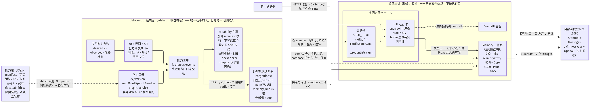
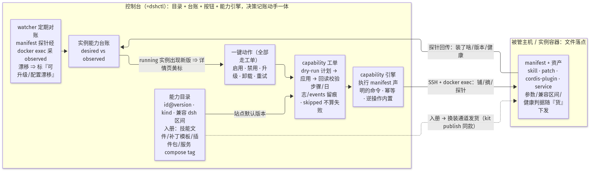
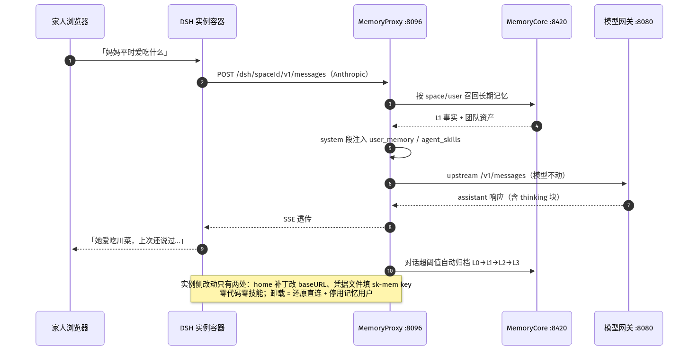

# TencentDB-Agent-Memory 与 Spec Kit 融入 dsh-control 分析

分析日期：2026-10-29。对象仓库：

- [TencentCloud/TencentDB-Agent-Memory](https://github.com/TencentCloud/TencentDB-Agent-Memory)（MIT，最新 release **v2.0.3**，2026-10-26 发布）
- [github/spec-kit](https://github.com/github/spec-kit)（MIT，`specify` CLI，Python 3.11+ / uv）

修订记录：

- v2：依据 v2.0.3 源码与官方 `agents/dsh/README.md` 修正——**Agent-Memory 官方已内置 DeepSeek Harness 集成**（初版按 GitHub README 旧叙事误判为「DSH 无适配」）。Spec Kit 铺实例开关按运维者要求改为**默认开**。
- v3：① 实测确认自部署模型网关支持 Anthropic Messages，**协议桥风险解除**；② 新增「能力插件化架构」章，两类库的能力统一为可插拔的能力包；③ 配三张架构图（`images/`，`.mmd` 源可再生）。
- v4（2026-10-29 口径修订）：经运维者澄清，**dshctl 即 dsh-control 控制台的简称**（取自域名 `dshctl.pipboy.cn`，与隧道前缀 `dshctl_`、版本戳 `kit/.dshctl-kit-version` 同源）。v3 误把 dshctl 当成「随 kit 分发到主机的独立执行器 CLI」，与运维者 2026-10-27「货全部收进 dshctl、dsh-family 收敛为造货」的既定方向相反。本版全部改为：**控制台既是编排账本、也是唯一执行者**（SSH + docker exec + deploy_jobs 现成机械）；能力包是被发的「货」，shell 知识装进清单（manifest）而非主机上的新二进制。配图与 ADR 同口径修订。
- v5（2026-10-29 增补）：① §7 清单全部取证闭环（详见该节）；② 新增硬要求——**记忆资产的管控不得脱离 dshctl 页面**（不做第二入口），Panel 嵌入方案比较与选型见 `docs/site/MEMORY-PANEL-EMBED.md`；③ ADR 评审点 U-1..U-8 除观察期项外全部定案（ADR 文末拍板记录）。

结论先行：

| 库 | 融入判定 | 融入形态 | 首选落点 |
|---|---|---|---|
| TencentDB-Agent-Memory | **官方有 DSH 集成，可直接用** | 服务端「Memory 三件套」（Core + Hub/Panel + Proxy），实例模型出口改指 Proxy，注入/归档全部透明发生；**DSH 侧零改动** | 站点共享三件套 + integrations 第 4 个适配器 + 开通链路写 home 层补丁的模型出口 |
| Spec Kit | **直接可用，成本最低** | 官方内置 `dsh` 集成，产物就是 `.dsh/skills/speckit-*/SKILL.md` | ① 本仓库开发流程采用 SDD；② 铺给每个实例，**site.toml 开关默认开** |
| 两者共同 | **暴露了能力管理的正确抽象** | 技能、补丁、Cordis 插件、外置服务统一为「能力包」；控制台（dshctl=dsh-control）既编排又执行，能力包只是「货」 | kit 能力清单 + 控制台能力目录/台账两张表 + 一键升级/禁用/卸载 |

---

## 1. 两个库是什么（只写与决策有关的事实）

### 1.1 TencentDB-Agent-Memory v2.0.3：面向 Agent 团队的记忆中枢

v2 已不是「个人记忆插件」，而是**团队 Memory Hub**。四个服务：

| 服务 | 默认端口 | 职责 |
|---|---|---|
| Memory Core | 8420 | 记忆读写与鉴权，L0–L3 沉淀、Skill 资产、检索数据面；存储默认 sqlite，Mongo 试验、TCVDB 可选 |
| Memory Hub / Panel | 8125 | 团队治理面板：建 Team / Agent / Task，审核、分享、配装记忆资产 |
| Knowledge | 8424 | Wiki / Code-Graph（可选） |
| **Memory Proxy** | 8096 | **LLM 请求代理**（Anthropic / OpenAI 双协议），记忆注入与归档都发生在这一层 |

**官方 DSH 集成走 Proxy 路线**（[agents/dsh/README.md](https://github.com/TencentCloud/TencentDB-Agent-Memory/blob/v2.0.3/agents/dsh/README.md)）：

- 实例侧只改配置：模型出口 baseURL 指到 `http://<memory-host>:8096/dsh/<spaceId>`（**不带 `/v1`**，官方明示 adapter 会拼 `/v1/messages`），密钥填 `PROXY_USER_KEY`。配置入口恰好是 **`cordis.patch.yml` + `.credentials.yaml`（chmod 600 硬校验）**——与 dsh-control 铺智能体团队用的同一层。
- 之后全部透明：Proxy 在 system 段注入 `<user_memory>` `<agent_skills>` 等，对话超阈值自动归档，首轮会话用 DSH 原生 `ask_user_question` 弹「是否关联团队资产」表单。短期压缩（offload / Mermaid 画布）也在服务端，**DSH 侧零代码零技能**。
- 记忆按 **space / Team / 业务用户（`sk-mem-…` 32 位 key）** 组织，跨 Agent、跨成员共享。对上 dsh-control 的世界：家人每人一个实例，记忆同属一个 Team——**记忆是团队资产，不随单个实例生死**。

### 1.2 Spec Kit

给编码 Agent 一套可安装的流程骨架（规格 → 计划 → 任务 → 实现 → 收敛），外加 bug 修复与想法评估两条扩展流程；产物全是仓库里的 Markdown（`.specify/`），白盒可审。

- **官方集成列表里有 DeepSeek Harness，key 是 `dsh`**：`specify init --integration dsh` 产物就是 `.dsh/skills/speckit-<command>/SKILL.md`，聊天里 `/speckit-specify` 调用；workflow 派发用 `dsh --profile headless`。
- bug 扩展有终判（`verified` / `partial` / `failed`），只有 `verified` 算修好——与「复核闸门不放水」同构。

### 1.3 现网实测：模型网关支持 Anthropic Messages（2026-10-29）

初版把「Proxy 到 vLLM 的协议桥」列为最大不确定点，当日实测解除：

- 站点模型网关 `http://192.168.3.109:8080`（radiance 1.12.0，容器 `llm-radiance-unc`）**原生支持 `POST /v1/messages`**：HTTP 200，返回标准 Anthropic 结构（`type:"message"`、`thinking` 块、`cache_*` usage 字段），`x-api-key` 鉴权与 system block array 均正常。
- MemoryProxy 的 anthropicHandler 对 upstream 自动拼 `/v1/messages`，故其 `upstream.agents` 配 `http://192.168.3.109:8080` 即可直连本站模型，**不需要中间协议桥**。
- 待观察项只剩一个：thinking 块的签名回传是否被 Proxy 的注入改写破坏（P0 联调验证，若模型端宽松则无影响）。

---

## 2. dsh-control 侧的既有锚点

| 锚点 | 代码位置 | 与本次的关系 |
|---|---|---|
| home 层补丁（不重建镜像改配置） | [capabilities.py](../../src/dsh_control/jobs/capabilities.py) `_team_patch_script` | 官方 DSH×记忆集成恰好靠 cordis.patch.yml 完成，同一机制复用 |
| 能力铺设（幂等，开通铺、重启补铺） | 同上，deploy 步骤 66；restart 里 `capabilities_ready` 对账 | 记忆、speckit 都走「第 N 项能力」的路；本章架构就是把它声明式化 |
| kit 整包换装 | ARCHITECTURE §6 步骤 20：`kit_releases` 对账、`kit/.dshctl-kit-version`、只增盖不动 `instances/` | **能力包随 kit 分发**的现成通道；`dshctl` 命名已在版本戳与隧道前缀里使用 |
| kit 内插件先例 | dsh-family `plugins/`（file-download 双包）、`rootfs/profile/cordis.patch.tmpl`、`gen-compaction-patch.sh` | kit 已在做「模板 + env 渲染」的半声明式铺设，差一个清单和状态回传 |
| 外部系统适配器 | [integrations/](../../src/dsh_control/integrations/)，base.py 冻结接口，全部带 noop | Memory Hub `/v3/meta/*`（建用户、verify、停用）= **第 4 个适配器** |
| 密钥管理 | `credentials` 表 + reveal-only + 日志脱敏 | 每实例 `sk-mem-…` user key 与站点 admin key 归这里 |
| 生命周期 | released 保留期 → purge | 新架构下**记忆不随 purge 消失**（记忆在 Hub 卷里，不在实例卷里），处置策略要定 |
| 复核闸门 | deploy 步骤 90 | 断言 baseURL = 站内记忆 Proxy、Proxy upstream = 站点模型网关 |

前提事实：DSH 自身有会话压缩但没有跨会话长期记忆；Proxy 路线两者都补。dsh-family 镜像自构建，**实例侧不需要任何新依赖**（记忆全在服务端）；Node ≥ 22.16 的要求只落在跑三件套的机器上。

---

## 3. 能力插件化架构：控制台动手也记账，能力包是「货」

总架构图（源文件 `images/capability-arch-1.mmd`）：



### 3.1 边界（回答「控制台和插件的边界要分清楚」）

**dshctl 就是 dsh-control**（域名前缀简称）——不存在第三个组件。所以边界只有一条线，画在「控制台」与「能力包」之间：

| 职责 | 控制台 dsh-control（=dshctl） | 能力包（「货」） |
|---|---|---|
| 是什么 | **唯一动手的人和唯一记账的人**：目录、台账、工单、密钥注入、审计，执行走现成机械（SSH + docker exec + deploy_jobs 步骤机 + kit 换装通道） | 自包含的声明 + 资产：manifest（幂等的铺法/卸法/探针命令）+ 文件正文 |
| 知道 | 能力 id、版本、参数 schema、期望状态、审计；**按 manifest 执行，不背每个能力的细节** | 自己怎么装/卸/量 |
| 不知道 | 技能正文怎么写、补丁怎么拼、compose 细节 | 哪个站点该开哪些能力、密钥、账本 |
| 现在 | 每个能力的 shell 知识硬编码在 `capabilities.py` 的 heredoc 里（等于把「货」的说明书印在了发货单上） | 无清单，逻辑散在两侧 |

收敛动作就一句话：**把 `capabilities.py` 里的 shell 知识整体搬进能力包的 manifest**，控制台改为通用解释器（执行清单里声明的命令，而非每个能力写死一段代码）。发布与下发复用 §6 步骤 20 的「货」通道（`dsh-control kit publish` 同款，能力包照此入册），不新造分发链路、不新增主机侧二进制。

### 3.2 能力清单（manifest）与四类能力

每个能力包一份 TOML，kit 目录 `capabilities/<id>/` 下与资产同放：

| kind | 装法 | 卸法 | 本批候选 |
|---|---|---|---|
| `skill` | 文件铺进 `$DSH_HOME/skills/<id>/` | 删目录 | comfy-image、speckit（默认开） |
| `patch` | 追加 home 层 `cordis.patch.yml`（带 marker） | 按 marker 摘除 | agent-team、office |
| `plugin` | npm 包进 profile `node_modules/` + 启用条目 | 反向 | file-download（已存在的两个自研包收编） |
| `service` | 主机级 compose 服务 + 实例接线（改 baseURL/凭据），外部 API 由控制台适配器管 | 实例还原直连 + 停用外部用户 | **memory-hub** |

manifest 最小字段：`id / version / kind / params（schema + 缺料策略 skipped|failed）/ compatible_dsh（版本区间）/ healthcheck（容器内命令）/ uninstall=reverse`。`service` 类多两个：`compose（镜像 tag 钉在清单里）/ external_api（指向控制台适配器名，如 memory_hub）`。

命令面长在社区已有的 `dsh-control fontlib publish / kit publish` 旁边（同一个管理 CLI），UI 与 API 是同一引擎的另两张脸：

```
dsh-control capability publish <pack-dir>                          # 货入册：manifest+资产进库，sha256 记账
dsh-control capability install|uninstall <instance> <id>[@ver]     # 密钥走 stdin，不进命令行
dsh-control capability enable|disable <instance> <id>
dsh-control capability status <instance> --json                    # 观测态：manifest 声明的探针经 docker exec 采集
```

工单（deploy job）、UI 点击、管理 CLI 三条路进的是同一个 capability 引擎与同一张台账；引擎落到实例上只有 SSH + docker exec，与开通步骤机同构。

### 3.3 升级与漂移（回答「今后 dsh、镜像、插件升级怎么维护」）

三层升级，各走各的既有通道，互不纠缠：

| 层 | 载体 | 通道 | 现状 |
|---|---|---|---|
| DSH 本体 | dsh-family 镜像 | 制品库 → `POST /api/instances/{id}/deploy {image}` 升级工单 | **已有**（§6.1.5、purpose=upgrade） |
| kit 脚本 + 能力包（都是「货」） | kit 目录（含 capabilities/），或独立能力包发布 | `kit_releases` 对账换装同款通道（`dsh-control kit publish` 一个口径），开通/升级步骤自动 | **已有通道**，缺清单化 |
| 记忆三件套等外部服务 | 官方镜像 tag 钉在能力清单里 | 控制台能力目录发布新 tag → 站点级升级工单（compose up -d），实例无感 | 新建，薄 |

能力升级闭环图（`images/capability-arch-2.mmd`）：



- 控制台两张新表：`capabilities`（目录：id、版本、kind、manifest 摘要、兼容 dsh 区间、发布状态）与 `instance_capabilities`（每实例每能力：desired 版本 ↔ observed 状态，来自 manifest 探针经 SSH docker exec 采集）。
- watcher 每轮采集时顺带对账：observed ≠ desired 或健康失败 → 详情页黄标 →「升级 / 重试 / 禁用 / 卸载」按钮 → 全部走工单（SSE 日志、失败续跑、events 留痕），与现有四类工单同构。
- **兼容闸门**：升级 DSH 镜像前先查各启用能力的 `compatible_dsh`，有冲突就拦（file-download 插件 README 自己写着：官方插槽改名时按钮会「安静地不画」——升级联动必须有闸门，不能靠肉眼）。
- 镜像升级后 `capabilities_ready` 重铺逻辑保留：home 层、技能目录重启后补验，缺则补铺。

### 3.4 speckit 是新机制的第一块试验田

speckit 走 `skill` 类（base64 内联推送，实例不出 PyPI；要 workflow 自动化再把 `specify` CLI 烙进镜像），**默认开、实例级可关**。它是唯一一个「纯新增、无历史包袱」的能力，用它把 manifest + 控制台能力引擎 + 台账闭环整套跑通；comfy-image、agent-team、fonts 随后收编，控制台侧删 heredoc。

---

## 4. TencentDB-Agent-Memory 怎么落地（走官方 Proxy 集成）

请求路径实测语义图（`images/capability-arch-3.mmd`）：



1. **部署形态：站点共享一套三件套**（推荐）。一台常在线机器跑官方 `deploy/global-images/start-all.sh`；全家 = 一个 Team，每实例一个业务用户，`spaceId` 做隔离粒度。与「记忆是团队资产」的产品语义一致；每机一套会让记忆不通，每实例一套是浪费。端口只在内网 docker 网络；Panel 要远程治理就用现成 nginxWebUI 机制建反代站点。
2. **第 4 个适配器** `integrations/memory_hub.py`：封装 `/v3/meta/*`（建用户、verify、停用），admin key 存 `credentials(kind=memory_admin_key)`，带 noop。
3. **开通链路插入**（容器起来后、复核前，即 `service` 类能力的实例接线）：建业务用户 → key 走 stdin 写 `.credentials.yaml`（600 硬校验）→ home 补丁写 baseURL（不带 `/v1`）→ `POST /v3/meta/auth/verify` 回读校验写 step detail。缺料（开关关/栈不通）→ skipped + 警告，**记忆没铺成不挡开通**。
4. **watcher**：探 Proxy 与 Core 健康；不健康**只记 events，不触发自动重启实例**——记忆层挂了实例还能用。
5. **purge 语义**：记忆在 Hub 卷、不在实例卷，**purge 不再连记忆一起删**。purge 工单增加「记忆处置」选项（保留 / 停用业务用户），默认保留并记 events；restore 回来 key 还在、记忆无缝续用。
6. **体验边界**：首轮会话弹「本次对话是否关联团队资产」表单，家人选「否」或输入「跳过」都行——接入记忆仅此一次人工交互。官方标注 DSH 集成「端到端验证通过、生产未大规模验证」，P0 观察期就是补这个验证。
7. **回退方案**：若 Proxy 路线现网不稳，退回 MemoryCore gateway(:8420) `/capture` `/recall` + 薄技能客户端。代价：只有长期记忆、无团队治理面板、注入靠手动。

---

## 5. Spec Kit 怎么融入

- **第一条线（先做，零风险）：本仓库开发流程采用 SDD。** `ARCHITECTURE.md` §0 硬性边界 + §2.0 数据库三条规矩整理成 `.specify/memory/constitution.md`；feature 走 specify → plan → tasks → implement → converge，产物落 `.specify/specs/`；ADR 记「定了什么决策」，`.specify/` 记「这个 feature 怎么来」。bug 修复装 bug extension，终判 `verified` 才算完。
- **第二条线：铺给每个实例，默认开。** `site.toml [speckit]` 默认开、实例级可关；核心 SDD 六件套先全铺，bug / assess 扩展按子项开关。作为 §3.4 新能力机制的首个试验田。
- **第三条线：借设计不借码。** bundle / catalog → 能力目录与清单的最小注册表（§3.2 已吸收）；extension hook 的前后置钩子暂不抄，工单步骤机够用。

---

## 6. 分期路线

| 期 | 内容 | 验收 |
|---|---|---|
| **P0 验证（并行三件）** | ① 一台富余机器 `start-all.sh` 起三件套，Proxy upstream 直配 `192.168.3.109:8080`，接一台现网实例观察一周（注入生效、归档增长、表单体验、thinking 块透传）；② 本仓库 `specify init --integration dsh` + constitution 迁移；③ 定稿 capability manifest 与控制台能力引擎契约（一页纸；v4 口径：引擎在控制台内，非主机 CLI） | ① 有「能用/不能用」结论 + 资源账；② spec-kit 走完一个真实 feature；③ 契约评审通过 |
| **P1 记忆入列** | memory_hub 适配器 + 开通链路接线 + watcher 探测 + 详情页小块 + purge 记忆处置 + 闸门扩容 | 新实例一键带记忆开出；关开关后行为与今天一致；purge/restore 回归通过 |
| **P2 能力机制落地** | kit `capabilities/` + 控制台 capability 引擎（integrations/capabilities.py 解释 manifest，执行复用 SSH+docker exec）+ `dsh-control capability` 管理子命令 + `capabilities` / `instance_capabilities` 两张表与页面一键动作；**speckit 默认开**，作为首个走新机制的能力 | 新开实例 `/speckit-specify` 直接可用；升级/禁用/卸载全在页面上完成 |
| **P3 收编存量** | comfy-image、agent-team、fonts 迁进清单，控制台删 heredoc；file-download 两个自研包登记进目录 | capabilities.py 只剩编排，不再有 shell 知识 |
| **P4 可选** | Panel 挂反代站点；记忆用户治理矩阵（批量停用/回收） | 视 P0/P1 结论 |

## 7. 待确认清单（2026-10-29 取证闭环）

1. **闭环**：thinking 块/签名回传本站网关实测接受（tool_use 声明、多轮 tool_result 往返全 200）；运维者确认「可接受」。
2. **闭环**：镜像内 dsh `0.2.1-rc.2` ≥ v0.2.0-rc.1；`dsh-llm-deepseek-api-key` 是 dsh npm 包的**内嵌依赖**（容器 `/usr/local/lib/node_modules/@deepseek-ai/dsh/node_modules/@deepseek-ai/` 实见），无需升级。
3. **闭环**：`$DSH_HOME/.credentials.yaml` 是 DSH 自己的 `records:` 存储，须**合并** `refs:` 段而非整写覆盖；600 权限 + 四台实例启动、鉴权全通过。
4. **闭环**：core 606 MiB / hub 79 MiB / proxy 92 MiB，CPU 空闲个位数（109 机余量充足）；三件套**不依赖 Redis**（sqlite/卷自足，站内已有 Redis 不需要新增）。
5. **闭环**：`/v3/meta/*` 共 55 接口，user/team/agent/task 增删查全通；**同名不去重**，幂等靠传确定性 `user_id`（适配器用 `dshctl-<slug>`）。
6. **观察期**：首轮 session-init 表单的家人体验（SSE 结构已实测正常，主观体验等人）。
7. **定案**：全家单 space（`default`），治理隔离交给 Team/Agent；ADR U-1。
8. **定案**：兼容闸门用现读口径（dump-config + `dsh_version_source`）；ADR U-2。

## 8. 一句话收束

Spec Kit 管「一件事该怎么做对」，Agent-Memory（v2 Memory Hub）管「团队做过的事别忘」；两者以同一种形态接入——**能力包**：dshctl 就是 dsh-control，唯一动手的人和唯一记账的人是同一个，能力包只是被它发货、解释、对账的「货」；镜像、kit、服务三层升级各走各的道。协议桥已被实测拆掉，P0 起三件套接一台现网实例，一周后有定论。
